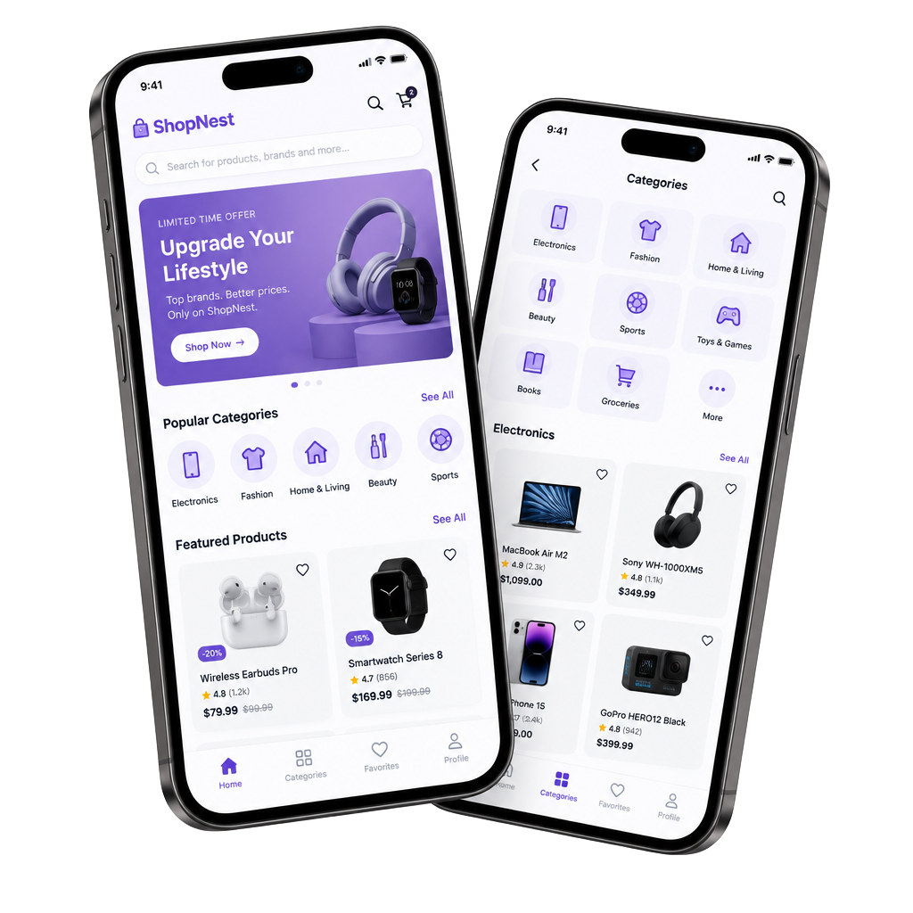

<div align="center">

  

# Vendora — SaaS Commerce Platform

**One Platform. Every Store. Endless Possibilities.**

A modern, high-performance multi-vendor commerce platform designed to empower independent businesses with self-serve digital storefronts while giving shoppers a unified, seamless marketplace experience.

  <br />

[](https://react.dev/)
[](https://www.typescriptlang.org/)
[](https://vitejs.dev/)
[](https://tailwindcss.com/)
[](https://tanstack.com/start)
[](https://tanstack.com/router)
[](https://vitest.dev/)

</div>

---

## Table of Contents

- [About Vendora](#about-vendora)
- [Visual Highlights](#visual-highlights)
- [Key Features](#key-features)
- [Technology Stack](#technology-stack)
- [Project Structure](#project-structure)
- [Getting Started](#getting-started)
  - [Prerequisites](#prerequisites)
  - [Installation & Local Setup](#installation--local-setup)
- [Available Scripts](#available-scripts)
- [Environment Variables](#environment-variables)
- [Roadmap](#roadmap)
- [Contributing](#contributing)
- [License & Acknowledgements](#license--acknowledgements)

---

## About Vendora

**Vendora** bridges the gap between independent merchants and discerning shoppers. Traditional e-commerce often forces small businesses to choose between complex, costly enterprise infrastructure or fragmented marketplace listings with limited brand identity.

Vendora solves this by providing:

- **For Merchants**: An intuitive path from onboarding to an operational digital storefront, complete with inventory management, sales analytics, and order tracking prototypes.
- **For Shoppers**: A curated, high-speed multi-store discovery engine featuring unified cart management, instant category filtering, customer reviews, and responsive mobile navigation.
- **For Platform Operators**: A clean full-stack architectural foundation built on TanStack Start (SSR), TanStack Router, and modern React 19 designed for modular scalability and API handoff.

---

## Visual Highlights

<table>
  <tr>
    <td align="center" width="50%">
      <strong>Hero Experience Artwork</strong><br />
      
    </td>
    <td align="center" width="50%">
      <strong>Mobile App Experience</strong><br />
      
    </td>
  </tr>
</table>

> 💡 _Full-page browser screenshots of the live marketplace and vendor dashboard can be generated and placed in `docs/screenshots/` for staging deployments._

---

## Key Features

### Implemented Functionality

- **Cinematic Brand Film Reveal**:
  - Art-directed 4-scene brand introduction with quiet arrival, physical contact shadows, optical horizontal wordmark unmasking, descriptor, and tagline.
  - Interactive controls including an immediate <kbd>ESC</kbd> / _Skip Intro_ action, optional Web Audio ambient synthesizer (muted by default), `prefers-reduced-motion` support, and a _Replay Intro_ hero trigger.
- **Modern Marketplace Homepage (`/`)**:
  - High-impact hero section with live search input, merchant trust badges, and quick category pills.
  - Dynamic **Category Strip** covering Fashion, Electronics, Home, Beauty, Sports, Books, and Gourmet Food.
  - **Featured Products** grid with interactive wishlist and cart quick-add actions.
  - **Top Rated Stores** directory spotlighting verified merchants and ratings.
  - **Customer Testimonials** carousel showcasing verified buyer feedback.
  - Curated promotional banners and deal alerts.
- **Product Catalog & Browsing (`/shop`)**:
  - Live query parameter search (`?q=`) and category filtering.
  - Sort by price, ratings, and relevance.
  - Dedicated **Product Detail View** (`/product/$id`) with gallery images, quantity counters, specifications, and related merchant links.
- **Merchant Directory (`/stores` & `/store/$id`)**:
  - Verified merchant listings with cover banners, ratings, and product counts.
  - Dedicated store storefront pages displaying merchant-specific catalogs.
- **Interactive Deals (`/deals`)**:
  - Time-sensitive promotional discounts and curated markdown highlights.
- **Cart & Wishlist State Management (`src/lib/cart.tsx`)**:
  - LocalStorage-backed reactive React Context store.
  - Real-time badge indicators in the global navigation bar.
  - Dedicated cart drawer/page (`/cart`) with quantity increment/decrement, tax/shipping computation, and order summary.
  - Dedicated wishlist page (`/wishlist`) for saved items.
- **Vendor Onboarding Workflow (`/become-a-vendor`)**:
  - Multi-step interactive registration wizard (Store Details, Contact Info, Business Category, Plan Selection).
  - Client-side validation with session state persistence.
- **Vendor Management Dashboard (`/vendor-dashboard`)**:
  - Authenticated session management (`src/lib/vendor-context.tsx`).
  - Interactive analytics cards with key metrics (revenue, orders, store visitors).
  - Recharts sales performance chart visualizing trends over time.
  - Product management table with search, status filters, and deletion controls.
  - Recent orders overview with order status pill indicators.
- **Vendor Pricing (`/pricing` & `/vendor-pricing`)**:
  - Tiered plan comparisons (Starter, Growth, Enterprise) with feature breakdowns.

---

## Technology Stack

| Category                    | Technology                                                                                 | Purpose                                                                 |
| --------------------------- | ------------------------------------------------------------------------------------------ | ----------------------------------------------------------------------- |
| **Frontend Framework**      | [React 19](https://react.dev/) (`19.2.0`)                                                  | Modern component-based declarative user interface                       |
| **Language**                | [TypeScript](https://www.typescriptlang.org/) (`5.8.3`)                                    | Strict end-to-end type safety for client and server code                |
| **Fullstack / SSR**         | [TanStack Start](https://tanstack.com/start) (`1.168.60`)                                  | Full-stack SSR framework with Nitro server engine                       |
| **Routing**                 | [TanStack Router](https://tanstack.com/router) (`1.170.41`)                                | 100% type-safe, file-based routing architecture                         |
| **Data Caching**            | [TanStack Query](https://tanstack.com/query) (`5.101.1`)                                   | Async state management, data caching, and server state coordination     |
| **Styling & Design Tokens** | [Tailwind CSS 4](https://tailwindcss.com/) (`4.2.1`)                                       | High-performance utility CSS with semantic OKLCH color tokens           |
| **UI Primitives**           | [Radix UI](https://www.radix-ui.com/)                                                      | Accessible, unstyled UI primitives (dialogs, dropdowns, tabs, popovers) |
| **Icons**                   | [Lucide React](https://lucide.dev/) (`0.575.0`)                                            | Modern, unified SVG iconography                                         |
| **Data Visualization**      | [Recharts](https://recharts.org/) (`2.15.4`)                                               | Responsive SVG charts for the vendor analytics dashboard                |
| **State Persistence**       | React Context + LocalStorage                                                               | Client-side reactive persistence for cart, wishlist, and vendor auth    |
| **Testing**                 | [Vitest](https://vitest.dev/) (`4.1.10`) + [Testing Library](https://testing-library.com/) | Fast unit and integration tests under JSDOM                             |
| **Build Tooling**           | [Vite](https://vitejs.dev/) (`8.1.5`)                                                      | Instant HMR development server and optimized rollup production bundles  |

---

## Project Structure

```text
vendora-saas-commerce-platform-7a8569fa/
├── public/                     # Static public assets (favicon, robots.txt)
├── src/
│   ├── assets/                 # Brand assets, logos, and product graphics
│   │   ├── logo-mark.png       # Official Vendora logo mark
│   │   ├── hero-shopper.png    # Homepage hero artwork
│   │   └── phones.png          # Mobile app showcase artwork
│   ├── components/
│   │   ├── cinematic/          # Art-directed brand film intro components
│   │   │   ├── CinematicIntro.tsx
│   │   │   ├── IntroBackground.tsx
│   │   │   ├── LogoReveal.tsx
│   │   │   ├── IntroTagline.tsx
│   │   │   ├── SoundToggle.tsx
│   │   │   └── intro-config.ts # Centralized intro timing & color tokens
│   │   ├── marketplace/        # Core commerce & storefront UI components
│   │   │   ├── Navbar.tsx      # Navigation header with cart/wishlist counters
│   │   │   ├── HeroSection.tsx # Landing hero with replay trigger
│   │   │   ├── CategoryStrip.tsx
│   │   │   ├── FeaturedProducts.tsx
│   │   │   ├── TopRatedStores.tsx
│   │   │   ├── Testimonials.tsx
│   │   │   ├── NewsletterBanner.tsx
│   │   │   └── Footer.tsx
│   │   └── ui/                 # Reusable Radix UI & design primitives
│   ├── data/                   # Swappable mock commerce data layer
│   │   ├── products.ts         # Catalog inventory, pricing, ratings
│   │   ├── stores.ts           # Merchant profiles and metrics
│   │   ├── categories.ts       # Marketplace category taxonomy
│   │   └── testimonials.ts     # Customer review quotes
│   ├── lib/                    # Shared utilities, crypto, and stores
│   │   ├── cart.tsx            # Cart & wishlist React Context store
│   │   ├── vendor-context.tsx  # Vendor authentication & session provider
│   │   ├── vendor-api.ts       # Vendor client API abstractions
│   │   └── utils.ts            # Class name merging & formatting utilities
│   ├── routes/                 # TanStack Router file-based route definitions
│   │   ├── __root.tsx          # Root shell layout with providers
│   │   ├── index.tsx           # Homepage route
│   │   ├── shop.tsx            # Product catalog & search
│   │   ├── product.$id.tsx     # Dynamic product detail page
│   │   ├── stores.tsx          # Merchant directory
│   │   ├── store.$id.tsx       # Dynamic merchant storefront page
│   │   ├── deals.tsx           # Promotional deals page
│   │   ├── cart.tsx            # Cart review & checkout
│   │   ├── wishlist.tsx        # Saved items
│   │   ├── become-a-vendor.tsx # Multi-step vendor registration
│   │   ├── vendor-dashboard.tsx# Merchant admin management dashboard
│   │   ├── pricing.tsx         # Platform pricing tiers
│   │   └── signin.tsx          # Authentication screen
│   ├── styles.css              # Global design system & semantic OKLCH tokens
│   └── test/                   # Vitest unit and integration test suite
├── package.json                # Project dependencies and script definitions
├── tsconfig.json               # TypeScript compiler configuration
└── vite.config.ts              # Vite & TanStack Start build configuration
```

---

## Getting Started

### Prerequisites

- **Node.js**: `v18.0.0` or higher (`v20+` recommended)
- **Package Manager**: `npm` (v9+) or `bun` (v1+)

### Installation & Local Setup

1. **Clone the repository**:

   ```bash
   git clone https://github.com/sohamghosh1762-max/vendora-saas-commerce-platform-7a8569fa.git
   cd vendora-saas-commerce-platform-7a8569fa
   ```

2. **Install dependencies**:

   Using npm:

   ```bash
   npm install
   ```

   _Alternatively, using Bun:_

   ```bash
   bun install
   ```

3. **Start the development server**:

   ```bash
   npm run dev
   ```

4. **Open in your browser**:

   Navigate to [http://localhost:8080/](http://localhost:8080/) to view the application with hot module replacement (HMR).

---

## Available Scripts

The following scripts are defined in `package.json`:

| Command                   | Purpose                                                                               |
| ------------------------- | ------------------------------------------------------------------------------------- |
| `npm run dev`             | Starts the local Vite development server with TanStack Start SSR on port `8080`.      |
| `npm run build`           | Compiles the client bundle and generates the Nitro server production output.          |
| `npm run build:dev`       | Runs the Vite build in development mode for debugging compilation output.             |
| `npm run preview`         | Starts a local web server to preview the production build output.                     |
| `npm run test`            | Executes the Vitest test suite once across all test files.                            |
| `npm run test:watch`      | Runs Vitest in interactive watch mode for test-driven development.                    |
| `npm run lint`            | Inspects code quality and enforces syntax conventions with ESLint.                    |
| `npm run format`          | Automatically formats codebase files using Prettier according to `.prettierrc`.       |
| `npm run admin:provision` | Generates PBKDF2 hash, salt, and session secret to provision the initial Super Admin. |

---

## Environment Variables & Super Admin Security

The marketplace storefront and vendor onboarding workflows operate self-contained out-of-the-box. Platform administration requires server-side administrator provisioning.

### Server-Side Super Admin Configuration

To configure the initial Super Admin account, copy `.env.example` to `.env.local` or set environment variables in your server environment:

| Variable                       | Purpose                                                                                 | Required / Default  |
| ------------------------------ | --------------------------------------------------------------------------------------- | ------------------- |
| `SUPER_ADMIN_EMAIL`            | Authorized administrator email address (e.g. `admin@vendora.com`).                      | Required            |
| `SUPER_ADMIN_PASSWORD_HASH`    | 64-byte hex PBKDF2-SHA256 password hash (100,000 iterations).                           | Required            |
| `SUPER_ADMIN_PASSWORD_SALT`    | 16-byte hex cryptographic salt used during password derivation.                         | Required            |
| `SUPER_ADMIN_SESSION_SECRET`   | 32+ byte high-entropy secret key for HMAC-SHA256 session token signatures.              | Required            |
| `SUPER_ADMIN_INITIAL_PASSWORD` | Optional local development convenience; derives hash/salt in-memory if hash is omitted. | Optional (dev only) |

### Provisioning the Initial Administrator

Run the automated provisioning script to generate secure values without exposing passwords in plain text:

```bash
npm run admin:provision <admin-email> <admin-password>
```

Example:

```bash
npm run admin:provision admin@vendora.com "StrongSuperAdminPass2026!"
```

The script will output `SUPER_ADMIN_EMAIL`, `SUPER_ADMIN_PASSWORD_HASH`, `SUPER_ADMIN_PASSWORD_SALT`, and `SUPER_ADMIN_SESSION_SECRET`. Add these lines to your `.env.local` file. Never commit `.env.local` or plaintext administrator passwords to Git.

### Security Architecture & Safeguards

- **Server-Side Authentication**: Credentials are validated exclusively on the server using constant-time timing-safe comparisons (`timingSafeEqual`) to prevent timing side-channel attacks.
- **Dedicated Role Separation**: Super Admin uses a strict `SUPER_ADMIN` role enforced on the server. Vendor merchant accounts (`vendor` role) are strictly forbidden from accessing `/super-admin-dashboard` or administrative APIs (HTTP 403 Forbidden).
- **Secure Sessions**: Super Admin sessions use HTTP-only, Secure, SameSite=Lax cookies (`vendora_admin_session`) carrying cryptographically signed HMAC-SHA256 tokens with server-side revocation tracking.
- **Rate Limiting**: Repeated failed login attempts are throttled server-side (5 failed attempts locks authentication for 15 minutes) to protect against brute-force attacks.
- **Generic Feedback**: The login endpoint returns generic error messages to prevent account enumeration.
- **Unconfigured Fail-Closed Safeguard**: When administrator environment variables are missing, administrator login is securely disabled, and an explicit administrative notice is displayed rather than allowing access or displaying fake credentials.
- **MFA Status**: Multi-Factor Authentication (MFA) via WebAuthn / hardware security tokens is architecturally prepared for platform milestone v2.5. In the current release, password-based PBKDF2 authentication with HTTP-only cookies and rate limiting is operational.

---

## Roadmap

Reference tracking from [`roadmap.md`](roadmap.md):

### Completed Milestones

- [x] Official brand identity assets and semantic OKLCH color token system.
- [x] Swappable data layer (`src/data/*`) for catalog, merchant profiles, and categories.
- [x] Reactive cart and wishlist state management with LocalStorage persistence.
- [x] File-based TanStack Router architecture with 15+ marketplace and informational routes.
- [x] Art-directed 4-scene brand introduction with accessibility and replay controls.
- [x] Multi-step interactive vendor onboarding registration wizard.
- [x] Vendor analytics and store management dashboard with Recharts visualizations.
- [x] Comprehensive Vitest test suite covering routing, components, and user workflows.

### Upcoming Architecture

- [ ] Integration with a live REST or GraphQL commerce backend.
- [ ] Production payment processor integration (Stripe / Razorpay).
- [ ] Real-time order status notifications and merchant push alerts.
- [ ] Multi-tenant role-based access control (RBAC) and vendor verification system.
- [ ] Internationalization (i18n) and multi-currency exchange rate support.

---

## Contributing

Contributions to Vendora are welcome. To contribute:

1. **Fork the repository** on GitHub.
2. **Create a feature branch**:
   ```bash
   git checkout -b feature/your-feature-name
   ```
3. **Commit your changes**: Ensure your code conforms to existing semantic design tokens (`src/styles.css`) and formatting rules:
   ```bash
   npm run format
   npm run lint
   npm test
   ```
4. **Push to your branch**:
   ```bash
   git push origin feature/your-feature-name
   ```
5. **Open a Pull Request**: Provide a clear description of the modifications, motivation, and include before/after screenshots for any user interface updates.

---

## License & Acknowledgements

- **License**: Licensing information has not yet been specified for this repository. All rights are reserved by the project owners.
- **Acknowledgements**: Originating project scaffolding was assisted by [Lovable](https://lovable.dev). Re-architected and maintained with TanStack Start, React 19, and Tailwind CSS.
